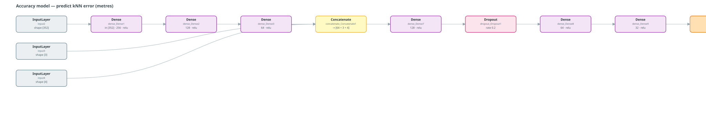
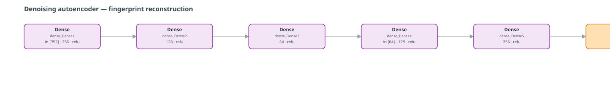
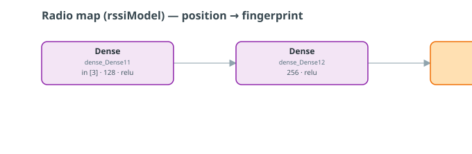

# Accuracy Model

This document explains the **AI-trained accuracy model** for WiFi fingerprinting:
what it predicts, how the architecture works, and every change made to it since
the original (never-completed) experiment. It is the authoritative reference for
`test/specs/AccuracyModel.ts`.

## The task

Radio-map (kNN) fingerprinting positions a device by matching its observed WiFi
scan against a map of reference fingerprints. Its positioning *error* varies a
lot with location and signal conditions: a corridor with a few strong, stable
APs localises to < 1 m; a spot behind a wall with a weak, mixed signal can be
5+ m off.

This model learns to **predict that positioning error** (in metres) for a given
scan. Inputs:

| input | meaning |
|---|---|
| `fingerprint` | one WiFi scan, RSSI per AP (`100` = not seen) |
| `x, y, z` | the position the kNN algorithm *estimated* (not the true one) |
| `k` | the k used by kNN |

The prediction is used to (a) report a confidence/accuracy together with a
localisation, and (b) build accuracy heatmaps. Because a *radio-map* model
(`rssiModel`) can synthesize a fingerprint for any `(x, y, z)`, accuracy can be
predicted for **unscanned** locations too — that is the pipeline that produced
`accuracy_results.json` and the heatmaps in `test/data/`.

## Architecture (`dense-v2`)

A fingerprint has no spatial structure (AP index order is arbitrary), so the
original 16×16 CNN was replaced with dense layers. Everything is TensorFlow.js
(`tfjs-node-gpu`), built in `AccuracyModel.ts`.



Three sub-models are trained (in `train()`):

1. **`encoder` + `decoder`** — a dense *denoising autoencoder*. A fingerprint is
   a vector of `2N` values: normalized RSSI (weakest → 0, strongest → 1, seen
   only) followed by a 0/1 *seen mask*. The loss (`fingerprintLoss`) penalises
   RSSI reconstruction **only for seen APs** (masked MSE) plus binary cross
   entropy on the mask — so the model never learns to reproduce the dominant
   "100 = missing" value. Training augments each scan by randomly masking 30% of
   seen APs, teaching it to denoise.

   

2. **`accuracyModel`** — the head above. Inputs `[fingerprint, stats, pos+k]`;
   the fingerprint is embedded by the encoder bottleneck. Loss is **Huber**
   (robust to the heavy-tailed error labels, which reach 20 m). Early stopping
   on `val_loss`, validation split **grouped by location** so the same location's
   fingerprints never appear in both train and validation.
3. **`rssiModel`** — the *radio map*: `(x, y, z)` → a synthesized fingerprint
   `[rssi, mask]`, trained with the same masked fingerprint loss. This is what
   makes accuracy predictable for arbitrary positions.

   

The hand-crafted fingerprint `stats` (`seen fraction`, mean/σ of seen RSSI) are
cheap, strong predictors that sit beside the learned bottleneck.

The diagrams above are auto-generated from the saved TF.js topologies:

```bash
node docs/generate_model_svg.js        # writes docs/model/*.svg
```

## Investigation history (what was tried, and why it was removed)

The architecture was A/B-tested on the full OpenHPS-2021-05 set (26,530 samples:
2,653 raw scans × k = 1..10), evaluated as **mean `|predicted − true kNN
error|`** on the test set. Runs were seeded so all configurations share the
*same* location split (an unseeded split adds ±0.1 m of noise that drowns small
differences).

| configuration | overall | k=1 | k=5 | k=10 |
|---|---|---|---|---|
| **frozen** (kept, baseline) | **1.20–1.31 m** | 1.42–1.56 | 1.18–1.27 | 1.18–1.29 |
| joint (fine-tune bottleneck) | 1.20–1.39 m | 1.36–1.67 | 1.16–1.36 | 1.14–1.29 |
| raw (no autoencoder) | 1.32 m | 1.44 | 1.24 | 1.26 |
| posonly (no fingerprint) | 2.05 m | 2.05 | 2.08 | 2.08 |
| joint + log1p target | 1.42 m | 1.66 | 1.34 | 1.42 |
| frozen + kNN-signal-dist feature | 1.70 m | 1.92 | 1.63 | 1.71 |
| **frozen ensemble ×3** | **1.20 m** | 1.45 | 1.15 | 1.13 |

Conclusions:

1. **The fingerprint is essential.** Dropping it (`posonly`) roughly doubles the
   error. The learned representation carries real signal.
2. **Ensembling is the only reliable improvement.** Averaging 3 independently
   trained models cuts error ~6–8 % (1.28 → 1.20, confirmed on two seeds),
   because it averages out the split/init noise that dominates this task.
3. **`frozen` vs `joint` vs `raw` are a statistical tie.** Fine-tuning the
   bottleneck or skipping the autoencoder neither reliably helps nor hurts —
   the differences are smaller than run-to-run variance. Only `frozen` (the
   autoencoder-pretrained, frozen bottleneck) is kept; the other variants were
   removed from the code.
4. **Log-target regression hurts.** Errors are heavy-tailed but Huber on raw
   metres already handles the outliers; predicting in log space made calibration
   worse. Removed.
5. **The kNN signal-distance feature hurts.** An extra feature (Euclidean
   distance to the nearest radio-map entry) sounded strong but added redundancy
   and noise (it correlates with `seen fraction` and is dominated by the
   missing-AP sentinel). Removed.

The single model predicts the kNN error to within **~1.0–1.3 m** on average
(true kNN error ≈ 2.5–2.9 m); the X,Y-only radio-map path is ~1.4–1.6 m off.

## What changed vs the original experiment

| area | original | now |
|---|---|---|
| Fingerprint encoder | 16×16 CNN over arbitrary AP order | dense denoising autoencoder with an explicit seen-mask channel |
| Normalization | `(rssi+max)/99` (wrong denominator); `predictRSSI` inverted with `f*99-99` | `(rssi − weakest)/(strongest − weakest)`; exact inverse `weakest + n·(strongest − weakest)`; `100` kept only for absent APs |
| Missing APs | conflated with weakest signal | separate 0/1 seen-mask channel |
| Accuracy loss | MSE (dragged by outliers) | Huber |
| Validation | random `validationSplit: 0.2` (location leak) | grouped-by-location split |
| Fingerprint stats | none | seen fraction + mean/σ of seen RSSI |
| Radio map | transposed-conv decoder reuse | dedicated dense `rssiModel` outputting `[rssi, mask]` |
| Save/load | hand-wired `apply()` reassembly of 5 models | one composed `accuracyModel` (embeds the encoder) + `rssiModel` + `encoder`/`decoder` |
| Speed | batch 32, fixed 250 epochs | batch 256 + `PATIENCE` early stopping (fires ~20–240) |
| Extras | — | `ENSEMBLE` knob; async `predict()`/`predictRSSI()` (WebGPU-safe reads) |
| Fixed bugs | — | undefined `x,y,z` in `src/services/FingerprintAccuracyService.ts`, dead test grep in `docker/docker-entrypoint.sh`, broken `src/services/index.ts` import |

## Training configuration (env vars)

| var | default | meaning |
|---|---|---|
| `EPOCHS` | 250 | max epochs per sub-model |
| `PATIENCE` | 20 | early-stopping patience (`0` disables) |
| `BATCH_SIZE` | 256 | training batch size |
| `ENSEMBLE` | 1 | number of models to train and average |
| `MODEL_DIR` | `test/data/model` | save location; ensemble members → `MODEL_DIR_1..N-1` |

## Reproducing / running

Full training runs as the `data.openhps.accuracy` mocha suite (see
`docker/docker-entrypoint.sh`) and is driven remotely by `scripts/` — see
`README.md` / `scripts/train_remote.sh`. Models are TF.js (`model.json` +
weights) under `test/data/model*`, loadable by `AccuracyModel.load()`.
